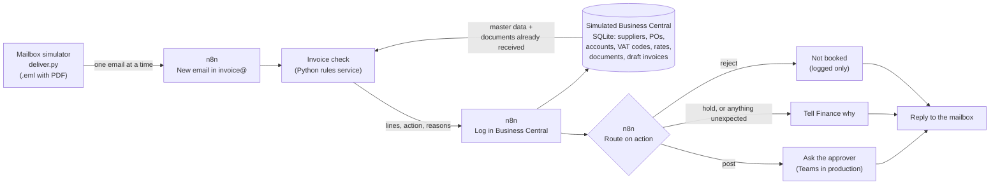
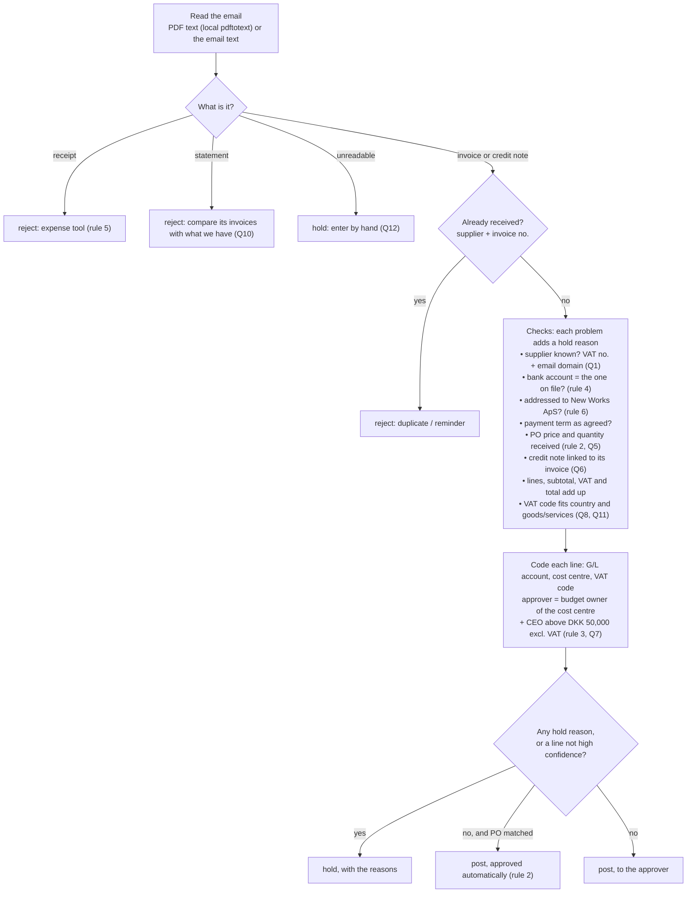
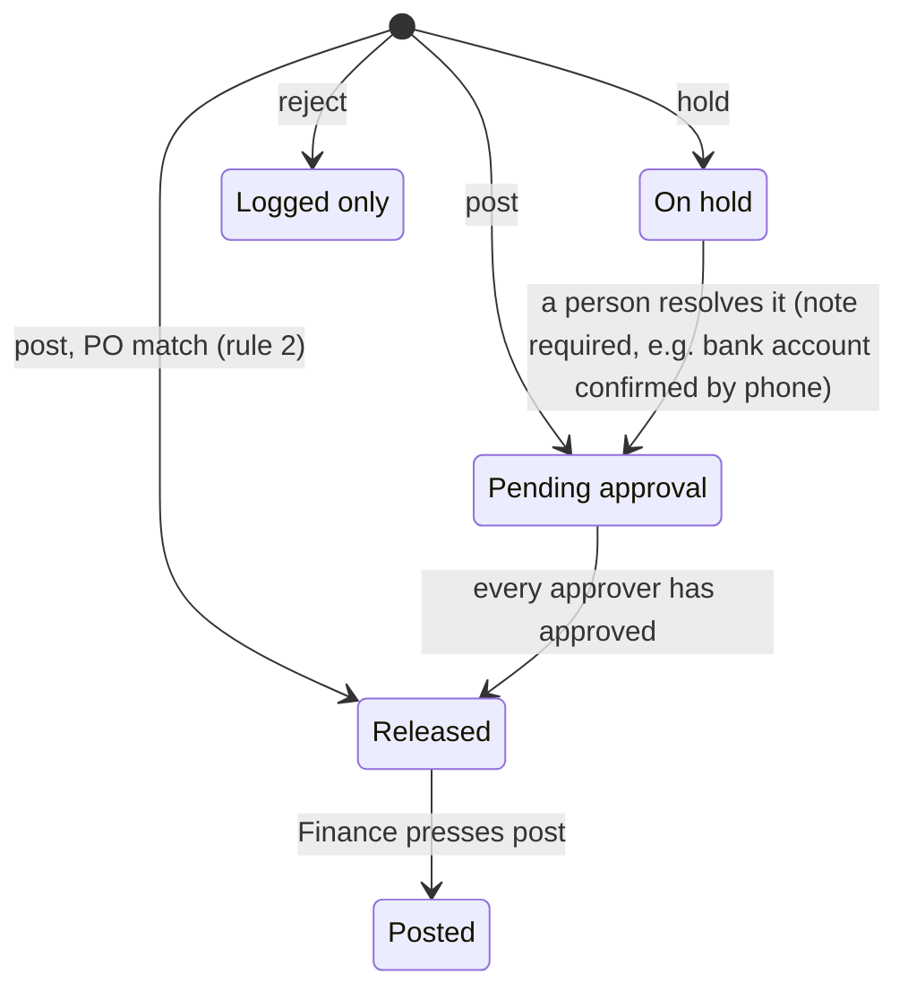

# Invoices without typing (New Works case B)

From the invoice mailbox to booking lines a person only has to approve. Every email in `invoice@` is read, coded
to G/L account, VAT code, cost centre and approver, and given an action: **post** (ready for approval),
**hold** (a person must check something first) or **reject** (not a supplier invoice, or already received).

- **Questions for Finance and the assumptions made instead:** [docs/questions.md](docs/questions.md)
- Finance's approval rules (case data): [approval_rules.md](case_B_invoices_without_typing/approval_rules.md)
- **The one-page note for Finance:** [docs/note_for_finance.pdf](docs/note_for_finance.pdf)

## Where it stands

All 16 case emails run end to end: mailbox simulator → n8n flow → rules → simulated Business Central.
The result matches the expected outcome agreed in [docs/questions.md](docs/questions.md);
`tools/check_expected.py` tests this, and `demo.py` runs it at the end of every demo.

| Action | Emails | Why |
|---|---|---|
| **post**, approved automatically | E03, E06 | Goods invoices that match the purchase order and what the warehouse received (rule 2) |
| **post**, waiting for the budget owner | E01, E02, E14, E15 | All checks pass; approver from the cost centre |
| **hold** | E04 | Unit price 3.30 USD above the purchase order (+396 USD); arrived 22 days after its date, due in 8 days |
| | E07 | Credit note: linked to invoice E06; deduct 620 EUR when paying |
| | E08 | German VAT on a German invoice; deposit; CEO needed (above DKK 50,000) |
| | E10 | **Different bank account and sender domain** from a known supplier; payment term changed |
| | E11 | New supplier, not in our list; coding is only a suggestion |
| | E16 | Invoice in the email text doesn't name New Works ApS as buyer (rule 6) |
| **reject** | E05 | Duplicate: payment reminder for E03 with the identical file |
| | E09, E12 | Receipts (card / private card): go to the expense tool (rule 5) |
| | E13 | Statement, not an invoice; lists 2 invoices we have no record of |

Full lines in the target format: `output/purchase_invoice_lines.csv` after a run.

**Nothing is paid by this tool, and nothing is posted without a person.** Even auto-approved invoices wait for
Finance to press post.

## Today, and with this tool

| Step today (Finance's description) | With this tool |
|---|---|
| Open each email every morning | Every email is read when it arrives and logged as an incoming document, including receipts, reminders and statements |
| Check the supplier exists; create it if not | Supplier recognised by VAT number **and** email domain; a new supplier is **held**, never created (Q1) |
| Type or correct fields; choose account, VAT code, cost centre | Read from the PDF or email text; coded by rules from the supplier list, PO lines and fixed tables |
| Compare PO price and quantity by hand | Compared to the cent against the PO and quantity received (rule 2, Q5) |
| Email the PDF to the approver and chase | Draft invoice waits in BC with its approver(s) and the reason; status shows what waits for whom |
| Duplicates found when the supplier says they were paid twice | Duplicate check on supplier + invoice number, on arrival (an identical file is named as extra evidence); BC also refuses to post the same invoice number twice |
| VAT wrong on foreign invoices | VAT code from supplier country and what they sell; foreign VAT on an invoice is held (Q8) |
| Late payment because the invoice sat in someone's mail | Says when an invoice arrived long after its date, or is due within 10 days (Q13) |

## The flow in the simulation



1. **`mailbox_sim/deliver.py`** sends one `.eml` file (a real email with its PDF attached) to the n8n webhook and waits until
   the flow has finished, so a reminder or credit note is always checked after the invoice it refers to.
2. **Invoice check** (Python) asks Business Central for the master data and the documents already received, reads
   the email, runs the checks and returns the booking lines with an action and a reason. It keeps nothing itself.
3. **Log in Business Central:** every email becomes an incoming document. Post and hold also become a draft purchase
   invoice with its lines.
4. **Route on action:** n8n only follows the action the check returned; it makes no decisions. Hold is the fallback
   route, so an unexpected value can never end as post.

### Inside the invoice check

All of this is plain code against the reference data. No AI is used in any step (see below).



### Draft invoices in Business Central



The simulated BC refuses to post anything that isn't Released, refuses approvers who aren't on the invoice,
and refuses a supplier invoice number that is already posted.

## Where AI helps, and where it doesn't

- **Not used in the build.** Every PDF in the case has a text layer, and the five languages are read reliably by
  their labels. Supplier and bank checks, PO matching, VAT codes, approvers, duplicates and the action are
  bookkeeping rules: they must give the same answer every time and be explainable, so they are plain code.
- **Where it could help later:** reading unknown layouts or languages (Q12). An AI model would only *propose* the
  fields; the same checks then decide, and anything that doesn't add up is held.
- **Never by AI:** paying, approving, changing bank details, creating suppliers, or choosing post.

## What leaves the machine

Nothing. PDFs are read locally, the services listen on this computer, and n8n runs in Docker with telemetry,
version checks and templates switched off. An AI fallback, if added later, would use a local model or a business
API without data retention, with bank details masked.

## When something fails

| What fails | What happens | Who notices |
|---|---|---|
| A PDF can't be opened or read | hold: "could not read this email… enter it by hand" | Finance, in the hold list |
| The rules service or BC is down | The flow stops; nothing is booked; the email waits in the mailbox | Prototype: the failed run in n8n. Production: an alert to Finance from Power Automate |
| An unexpected action value | n8n's fallback route is hold | Finance, in the hold list |
| A rule changes the expected result | `tools/check_expected.py` fails before the demo/release | Whoever runs it (us) |

## How to run it

Python 3.12, standard library only (nothing to install), plus `pdftotext` (Poppler). n8n needs Docker.

**The demo:** `docker compose up -d`, then `python demo.py`. It starts the two services if needed and walks through
the morning in 7 steps, with a cue for each part. Open
**http://localhost:8100**: the review page in the simulated Business Central. It shows invoices on hold (sorted by
due date), waiting for approval, ready to post and posted, each with its reasons, booking lines, history and the
Resolve / Approve / Post buttons. Without n8n: `python demo.py --direct`.

Step by step instead:

```bash
# 1. Rules only, no services (quickest check)
python -m tools.run_batch && python -m tools.check_expected

# 2. Start simulated Business Central and the invoice check
python -m bc_sim.server --host 0.0.0.0          # port 8100
python -m invoice_engine.service --host 0.0.0.0 # port 8101

# 3. Start n8n (first time: import the flow, see below); UI on http://localhost:5678
docker compose up -d

# 4. Build the mailbox and deliver the emails through n8n
python -m mailbox_sim.build
python -m mailbox_sim.deliver --all --reset       # all 16, in arrival order, from an empty BC
python -m mailbox_sim.deliver E10                 # or one at a time

# Fallback without n8n (same steps)
python -m mailbox_sim.deliver --all --reset --direct
```

First-time n8n setup (the flow file in the repo is the source):

```bash
docker exec newworks_n8n n8n import:workflow --input=/files/invoice_flow.json
docker exec newworks_n8n n8n publish:workflow --id=NwInvoiceFlow001
docker restart newworks_n8n
```

Approving and posting in the simulated BC, without the page (what Finance and the approvers would do in Business Central):

```bash
curl http://127.0.0.1:8100/purchase-invoices?status=On%20hold
curl -X POST http://127.0.0.1:8100/purchase-invoices/PI-0004/approve -H "Content-Type: application/json" -d "{\"by\": \"CMO\"}"
curl -X POST http://127.0.0.1:8100/purchase-invoices/PI-0004/post    -H "Content-Type: application/json" -d "{\"by\": \"Finance\"}"
```

## In production

The demo uses n8n because it runs locally without a work account. At New Works the same steps would run in
**Power Automate + Business Central**:

| Demo | Production |
|---|---|
| `mailbox_sim/deliver.py` → n8n webhook | Power Automate "When a new email arrives (V3)" on invoice@ |
| Invoice check (Python service) | The same Python, as an Azure Function or behind an HTTP action; later the rules can move into an AL extension |
| Simulated Business Central and its review page | Business Central: incoming documents, purchase invoices, approval entries, vendor bank accounts, currency exchange rates |
| Route on action | Condition / Switch on `action` |
| Ask the approver | Approvals "Start and wait for an approval" (Teams), or BC's own approval workflows |

Field names and endpoints in the simulated BC are our own, not Business Central's API.

## Build or buy

- **Use what New Works already has:** Power Automate to pick up the emails, and Business Central for approvals
  (in Teams), posting and payment.
- **Check the existing document capture tool first** (Q2): it may be able to take over more of the reading
  before any more reading logic is built.
- **Build only New Works' own checks** (supplier and bank account, PO match, VAT, approvers, duplicates): no
  standard product knows these rules. They are kept in small tables (`config/`, supplier data in BC) that
  Finance can change.
- Compare this with the freelance CFO's recommendation before deciding.

## Repository

```
├── demo.py                          the live demo (start here)
├── invoice_engine/                  the invoice check: all rules live here
│   ├── extract.py                   reading PDFs and email text into fields (five languages)
│   ├── rules.py                     bookkeeping rules and checks (rules 1–6, Q1–Q13)
│   ├── reference.py                 master data (from CSVs or BC) and documents already received
│   ├── service.py                   the check as a local web service (/process, /process-eml)
│   ├── bc_client.py                 reads master data and earlier documents from BC
│   └── httpjson.py                  tiny JSON web server/client (standard library)
├── bc_sim/                          simulated Business Central (SQLite) and its review page
├── mailbox_sim/                     mailbox simulator: build.py (.eml files), deliver.py (to n8n)
├── tools/                           run_batch.py (all 16 without services), check_expected.py (the test)
├── config/                          our rule tables: forwarder lines, suggestions, demo exchange rates
├── n8n/invoice_flow.json            the n8n flow
├── docs/questions.md                questions for Finance and the assumptions made instead
├── docs/note_for_finance.pdf        the one-page note for Finance
├── case_B_invoices_without_typing/  case data, never modified
├── docker-compose.yml               n8n
└── output/                          generated by runs, not in the repo (database, logs, booking file)
```

## Known limits

- Reading rules cover the five languages and layouts in the case; a new layout is held, not guessed.
- Exchange rates are a fixed demo table; production uses BC's rate on the invoice date.
- The simulated BC mimics the shape of Business Central, not its API.
- Payment is out of scope: nothing here pays.
